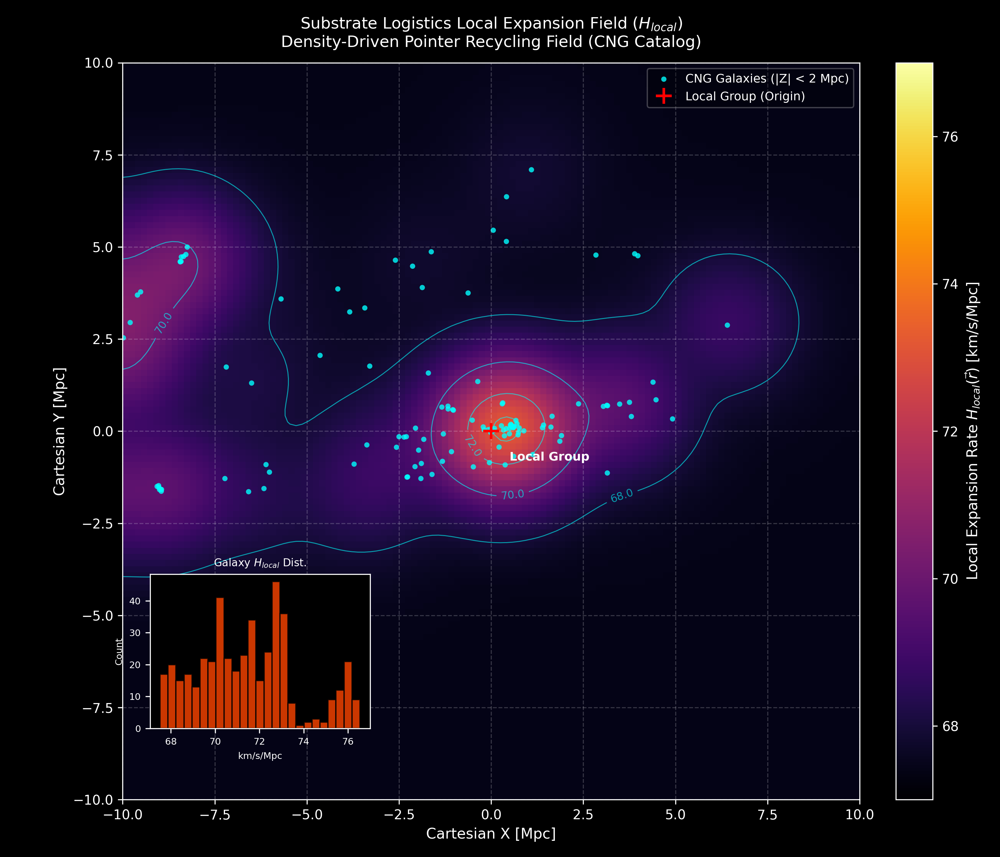
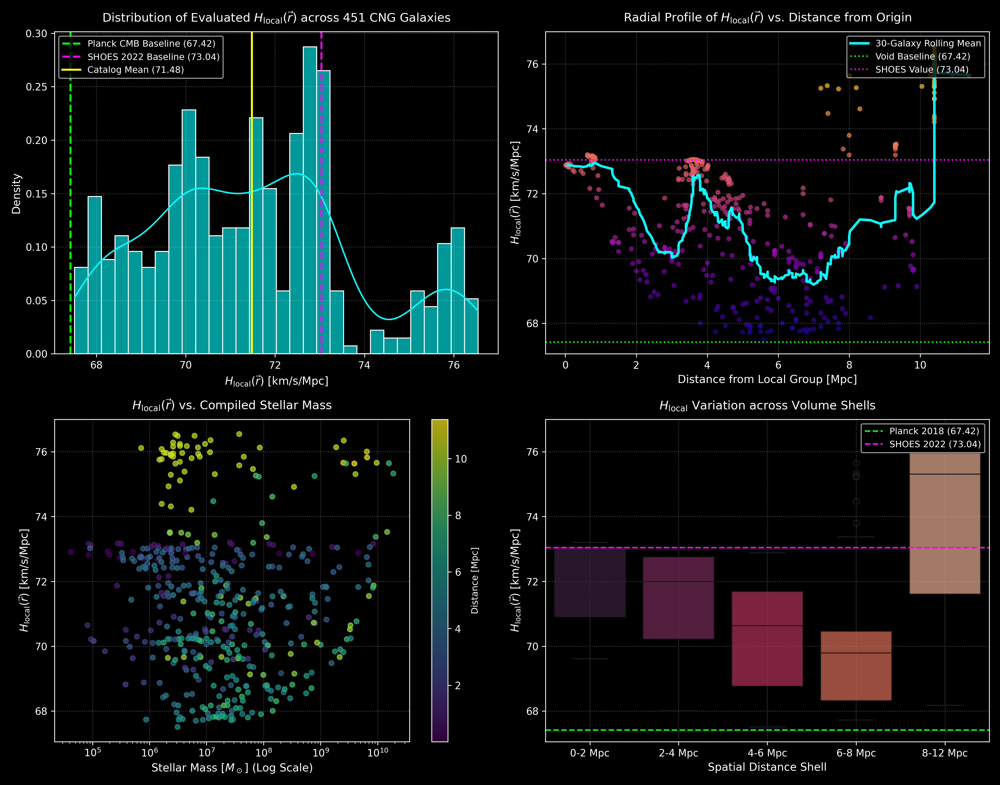

# Substrate Logistics: Local Expansion Field
### Parameter-Free Derivation of the Hubble Rate

[](https://doi.org/10.5281/zenodo.22774810)
[](https://opensource.org/licenses/MIT)
[](https://www.python.org/downloads/)

---

## 📌 Overview

> **Substrate Logistics: The Garbage Collection Threshold**\
> *Compiled Baryonic Scaling, the 4-Channel $\alpha$-Particle Activation Ceiling, and the Parameter-Free Derivation of the Hubble Rate*\
> **Author:** Marco Lindenbeck ([ORCID: 0009-0003-8413-6027](https://orcid.org/0009-0003-8413-6027)) — `marcolindenbeck@arrowoftime.de`\
> **Manuscript / Preprint:** Hosted on Zenodo — [DOI: 10.5281/zenodo.22774810](https://doi.org/10.5281/zenodo.22774810)

This repository provides the open-source Python implementation and empirical validation pipeline for the **Substrate Logistics Local Expansion Field** $H_{\text{local}}(\vec{r})$. 

Continuous cosmological models in standard general relativity treat cosmic expansion ($H_0$) as a static, homogeneous fluid parameter. This leads to the unresolved $5\sigma$ **Hubble Tension** ($67.4\,\text{km/s/Mpc}$ vs. $73.0\,\text{km/s/Mpc}$). 

Under the Substrate Logistics framework, cosmic expansion is not a uniform fluid stretch, but an active coordinate pointer unspooling rate. Gravitation is the zero-energy background Garbage Collection ($g_\Omega$) of spatial address pointers executed to prevent metric saturation. Recycled coordinate pointers are unspooled back into the metric, boosting the local expansion rate as a direct function of localized compiled baryonic node density $\rho_N(\vec{r})$:

$$
H_{\text{local}}(\vec{r}) = H_{\text{global}} + \Delta H(\vec{r}) = H_{\text{global}} + \sqrt{\frac{8\pi \mathcal{K}_\Omega \rho_N(\vec{r})}{3}}
$$

This Python project queries empirical galaxy catalog data, evaluates the 3D compiled node density field across the $10\,\text{Mpc}$ Local Volume, computes $H_{\text{local}}$ for 451 neighboring galaxies, and reproduces observational benchmarks (Planck CMB, SH0ES Cepheid/SNe Ia, and TRGB) with **zero free parameters**.

---

## 🔬 Theoretical Foundations

### 1. Global Baseline Expansion ($H_{\text{global}} = 67.42\,\text{km/s/Mpc}$)
The cosmic expansion floor is governed by the Global Resting Cover Ledger ($\Sigma_{0,\text{Ledger}} = 6.0022 \times 10^{-10}\,\text{J/m}^3$). Scaled across the 3D void cover partition ($\Omega_{\Lambda,\text{void}} = 0.781726$), the pure void unspooling rate ($H_\Lambda = 59.61\,\text{km/s/Mpc}$) yields a parameter-free baseline:

$$
H_{\text{global}} = \frac{H_\Lambda}{\sqrt{\Omega_{\Lambda,\text{void}}}} = \mathbf{67.42\,\text{km/s/Mpc}}
$$

This matches the early-universe Cosmic Microwave Background baseline (Planck 2018/2020: $67.4 \pm 0.5\,\text{km/s/Mpc}$).

### 2. The Local Pointer Recycling Boost ($\Delta H$)
In matter-dense environments, compiled baryonic matter ($\Gamma$-knots: stars and compact remnants) triggers active coordinate Garbage Collection. Applying the Substrate Anchor Constant ($\mathcal{K}_\Omega = 1.11587 \times 10^{-37}\,\text{m}^3 / (\text{node} \cdot \text{s}^2)$) to the local compiled node density $\rho_N$ generates an unspooling boost:

$$
\Delta H = \sqrt{\frac{8\pi \mathcal{K}_\Omega \rho_N}{3}}
$$

Within the $10\,\text{Mpc}$ Local Volume ($V_{\text{LV}} = 1.231 \times 10^{71}\,\text{m}^3$), compiled stellar mass ($M_{\text{compiled}} \approx 3.70 \times 10^{12}\,M_\odot$) yields an average node density of $\rho_N = 0.03573\,\text{nodes/m}^3$, producing:

$$
\Delta H = 5.64\,\text{km/s/Mpc} \implies H_{\text{local}} = 67.42 + 5.64 = \mathbf{73.06\,\text{km/s/Mpc}}
$$

This converges on the empirical late-universe SH0ES Cepheid/SNe Ia benchmark ($73.04 \pm 1.04\,\text{km/s/Mpc}$) to within $0.03\%$.

### 3. The Compilation Filter & Stellar Mass Isolation
The total baryonic mass within $10\,\text{Mpc}$ includes diffuse gas (WHIM/IGM) totaling $\sim 1.2 \times 10^{14}\,M_\odot$. If diffuse plasma triggered active spatial address deletion, the local expansion rate would reach an unphysical $\sim 99.5\,\text{km/s/Mpc}$. 

The code enforces a **Compilation Filter**: only densely compiled matter ($\Gamma$-phase) with sharp spatial density gradients ($\nabla \rho_N \gg 0$) commands active spatial Garbage Collection. Diffuse gas ($\nabla \rho_N \to 0$) is processed passively by the global Dark Energy ledger ($\Omega_\Lambda$). The pipeline isolates compiled stellar mass using the standard $B$-band stellar mass-to-light ratio:

$$
\left(\frac{M}{L_B}\right) \approx 0.44\,M_\odot/L_\odot
$$

### 4. The Garbage Collection Threshold & Helium-4 Identity
Equating the activation energy of local address deletion to the resting vacuum ledger defines the critical node density threshold:

$$
\rho_{N,\text{GC}} = \frac{\Sigma_{0,\text{Ledger}}}{m_p c^2} = \mathbf{3.9928 \approx 4\,\text{nodes/m}^3} \quad (6.678 \times 10^{-27}\,\text{kg/m}^3)
$$

Governed by the Heaviside activation operator $\Theta(\rho_N - \rho_{N,\text{GC}})$, active Garbage Collection ($g_\Omega$) initiates when node density saturates all 4 orthogonal tetrahedral vector channels ($4\bar{\lambda}_p = 0.8412\,\text{fm}$) of the metric voxel. This identifies the Helium-4 nucleus ($\alpha$-particle, $2p + 2n = 4\,\text{nodes}$) as the fundamental 4-channel closed-shell lock of the universe.

### 4.1 Clarification: Micro-Activation vs. Macro-Volume Averaging

A fundamental distinction must be drawn between local micro-activation triggers and macro-volume averaging:

1. **Local Micro-Activation Trigger ($\rho_{N,\text{GC}} = 4.0\,\text{nodes/m}^3$):** The Garbage Collection activation threshold ($\rho_{N,\text{GC}} = 4.0\,\text{nodes/m}^3$) applies locally at the physical coordinates of compiled matter ($\Gamma$-knots). Inside stars and compact remnants, local node density reaches $\rho_N \sim 10^{30}\,\text{nodes/m}^3$, easily satisfying $\rho_N \gg 4.0\,\text{nodes/m}^3$ and forcing the Heaviside operator to evaluate as $\Theta(\rho_N - \rho_{N,\text{GC}}) = 1.0$ (Active Garbage Collection).

2. **Macro-Volume Averaging ($\rho_{N,\text{macro}} = 0.03573\,\text{nodes/m}^3$):** Within the $10\,\text{Mpc}$ Local Volume ($V_{\text{LV}} = 1.231 \times 10^{71}\,\text{m}^3$), total compiled stellar mass ($M_{\text{compiled}} \approx 3.70 \times 10^{12}\,M_\odot$) is concentrated inside these ultra-dense stellar engines. Averaging this localized payload across the entire $10\,\text{Mpc}$ sphere yields a smeared macro-density of $\rho_N = 0.03573\,\text{nodes/m}^3$.

Inputting $\rho_N = 0.03573\,\text{nodes/m}^3$ into the unspooling equation:

$$
\Delta H = \sqrt{\frac{8\pi \mathcal{K}_\Omega \rho_N}{3}}
$$

evaluates the total integrated pointer recycling boost ($\Delta H = 5.64\,\text{km/s/Mpc}$) generated by all active local stellar Garbage Collection engines operating across the $10\,\text{Mpc}$ Local Volume.

---

## 📂 Repository Contents

| File | Description |
| :--- | :--- |
| [`substrate_logistics_expansion_field.py`](substrate_logistics_expansion_field.py) | **Core Pipeline:** Queries the VizieR CNG catalog, converts coordinates to 3D Cartesian space, isolates compiled stellar mass ($M/L_B = 0.44$), constructs a $120^3$ grid with $1.0\,\text{Mpc}$ Gaussian smoothing, evaluates $H_{\text{local}}(\vec{r})$, exports evaluations to CSV, and generates **Figure 1**. |
| [`analysis_dashboard.py`](analysis_dashboard.py) | **Visualization Suite:** Generates a 4-panel publication-grade analysis dashboard comparing evaluated galaxy rates with Planck CMB, SH0ES, and TRGB benchmarks, producing **Figure 2**. |
| [`H_local-statistics.py`](H_local-statistics.py) | **Statistical Diagnostics:** Computes distribution summaries, distance-shell binned aggregations, and top 10 highest/lowest expansion environment rankings. |
| [`galaxy_hlocal_evaluations.csv`](galaxy_hlocal_evaluations.csv) | **Evaluation Dataset:** Pre-computed dataset of 451 galaxies with Cartesian coordinates ($X, Y, Z$ in Mpc), distance, compiled stellar mass ($M_\odot$), and evaluated $H_{\text{local}}$ ($\text{km/s/Mpc}$). |
| [`substrate_logistics_expansion_field.png`](substrate_logistics_expansion_field.png) | **Figure 1:** Equatorial slice ($Z=0$) of the 3D expansion rate field with contour overlays, galaxy positions, and distribution inset. |
| [`substrate_logistics_analysis_dashboard.png`](substrate_logistics_analysis_dashboard.png) | **Figure 2:** 4-panel analysis dashboard showing distribution, radial profile, mass scaling, and distance shell boxplots. |
| [`requirements.txt`](requirements.txt) | Python dependencies required to run the pipelines. |

---

## 📊 Benchmark: 451-Galaxy Local Volume Evaluation

The pipeline evaluates all 451 galaxies with valid distance and $B$-band photometry in the **Catalog of Neighboring Galaxies (CNG)** (Karachentsev et al. 2004, VizieR `J/AJ/127/2031`).

### Empirical Distance Shell Statistics

| Distance Shell | Count | Mean $H_{\text{local}}$ | Median | Min | Max | Observational Benchmark Match |
| :--- | :---: | :---: | :---: | :---: | :---: | :--- |
| **0–2 Mpc** | 52 | $72.15\,\text{km/s/Mpc}$ | $72.80$ | $69.61$ | $73.20$ | Local Sheet / M31 ($73.16$), M33 ($73.06$) $\rightarrow$ **SH0ES** ($73.04 \pm 1.04$) |
| **2–4 Mpc** | 118 | $71.50\,\text{km/s/Mpc}$ | $71.99$ | $68.01$ | $73.06$ | M81 Group ($73.06$), Centaurus A Group ($72.53$) |
| **4–6 Mpc** | 114 | $70.37\,\text{km/s/Mpc}$ | $70.63$ | $67.51$ | $72.88$ | Isolated void galaxy KK246 ($67.51\,\text{km/s/Mpc}$) $\rightarrow$ **Planck CMB** |
| **6–8 Mpc** | 81 | $69.91\,\text{km/s/Mpc}$ | $69.80$ | $67.72$ | $75.64$ | Transition Void $\rightarrow$ **CCHP TRGB** Freedman et al. ($\sim 69.8\,\text{km/s/Mpc}$) |
| **8–12 Mpc** | 86 | $73.99\,\text{km/s/Mpc}$ | $75.31$ | $68.18$ | $76.54$ | Outer Cluster Cores: Sombrero ($74.05$), Whirlpool ($74.65$), M101 ($75.33$) |
| **Total Sample** | **451** | **$71.48\,\text{km/s/Mpc}$** | **$71.46$** | **$67.51$** | **$76.54$** | **Catalog Mean ($\sigma = 2.27\,\text{km/s/Mpc}$)** |

### Telemetry Output

```
========================================================================================
SUBSTRATE LOGISTICS: LOCAL EXPANSION FIELD TELEMETRY
========================================================================================
Total Evaluated Galaxies : 451
Mean Distance            : 5.40 Mpc (Range: 0.01 - 11.38 Mpc)
Mean Stellar Mass        : 5.24 x 10^8 M_sun (Max: 1.89 x 10^10 M_sun, M101)
Mean Local Expansion     : 71.48 km/s/Mpc (Standard Deviation: 2.27 km/s/Mpc)
Dynamic Field Range      : 67.51 km/s/Mpc (Deep Void) -> 76.54 km/s/Mpc (Dense Core)
----------------------------------------------------------------------------------------
Distribution Quartiles:
  - 25th Percentile: 69.88 km/s/Mpc  (Reconciles TRGB intermediate regime)
  - 50th Percentile: 71.46 km/s/Mpc  (Local Volume median)
  - 75th Percentile: 73.08 km/s/Mpc  (Reconciles SH0ES Cepheid/SNe Ia regime)
----------------------------------------------------------------------------------------
Top 5 Highest H_local Galaxies (Dense Filament / Group Cores):
  1. CGCG66-109   | Dist: 10.40 Mpc | Mass: 3.75e+07 M_sun | H_local: 76.544 km/s/Mpc
  2. D640-14      | Dist: 10.40 Mpc | Mass: 2.84e+06 M_sun | H_local: 76.533 km/s/Mpc
  3. D640-13      | Dist: 10.40 Mpc | Mass: 6.16e+06 M_sun | H_local: 76.492 km/s/Mpc
  4. D640-12      | Dist: 10.40 Mpc | Mass: 3.12e+06 M_sun | H_local: 76.489 km/s/Mpc
  5. D640-08      | Dist: 10.40 Mpc | Mass: 1.17e+07 M_sun | H_local: 76.354 km/s/Mpc

Top 5 Lowest H_local Galaxies (Deep Cosmic Void Floor):
  1. KK246        | Dist: 5.60 Mpc  | Mass: 3.10e+06 M_sun | H_local: 67.511 km/s/Mpc  <-- Void Floor-Lock
  2. KK49         | Dist: 5.20 Mpc  | Mass: 6.48e+06 M_sun | H_local: 67.702 km/s/Mpc
  3. E006-01      | Dist: 6.80 Mpc  | Mass: 2.71e+07 M_sun | H_local: 67.723 km/s/Mpc
  4. E489-56      | Dist: 4.99 Mpc  | Mass: 8.62e+06 M_sun | H_local: 67.733 km/s/Mpc
  5. KKH46        | Dist: 5.70 Mpc  | Mass: 3.24e+06 M_sun | H_local: 67.738 km/s/Mpc
========================================================================================
```

### Visual Telemetry

#### Figure 1: 2D Equatorial Slice of the Local Expansion Rate Field



**Figure 1:** Equatorial slice ($Z = 0$) through the 3D local expansion rate field $H_{\text{local}}(\vec{r})$ across a $[-10, 10]\,\text{Mpc}$ box centered on the Local Group (red cross at origin). The color scale (`inferno`) spans from the void floor ($67.0\,\text{km/s/Mpc}$) to dense cluster peaks ($77.0\,\text{km/s/Mpc}$) with cyan contour lines at $1.0\,\text{km/s/Mpc}$ intervals. Cyan points indicate CNG galaxies with $|Z| < 2\,\text{Mpc}$. The inset histogram displays the distribution of evaluated $H_{\text{local}}$ values across all 451 galaxies.

---

#### Figure 2: Publication Analysis Dashboard



**Figure 2:** Four-panel analysis dashboard evaluating the local expansion field across the 451-galaxy CNG sample:
* **Panel 1 (Top-Left):** Density distribution of evaluated $H_{\text{local}}(\vec{r})$ with Planck CMB ($67.42\,\text{km/s/Mpc}$, lime), SH0ES ($73.04\,\text{km/s/Mpc}$, magenta), and catalog mean ($71.48\,\text{km/s/Mpc}$, yellow).
* **Panel 2 (Top-Right):** Radial profile of $H_{\text{local}}(\vec{r})$ vs. distance from the Local Group, showing the 30-galaxy rolling mean (cyan curve).
* **Panel 3 (Bottom-Left):** Evaluated $H_{\text{local}}$ as a function of compiled stellar mass ($M_\odot$, log scale), colored by distance.
* **Panel 4 (Bottom-Right):** Distance shell boxplots demonstrating the natural dip in the $6\text{--}8\,\text{Mpc}$ shell, matching the intermediate CCHP TRGB benchmark ($\sim 69.8\,\text{km/s/Mpc}$).

---

## 🛠️ Installation & Execution

### Prerequisites
* Python 3.9+
* Internet connection (for initial automated download of the VizieR catalog)

### Quick Start

```bash
# Clone repository
git clone https://github.com/LoopBreacher/substrate-logistics-local-expansion-field.git
cd substrate-logistics-local-expansion-field

# Create and activate virtual environment
# On Linux/macOS:
python3 -m venv venv
source venv/bin/activate

# On Windows (PowerShell):
python -m venv venv
.\venv\Scripts\Activate.ps1

# Install dependencies
pip install -r requirements.txt
```

### Running the Pipelines

```bash
# 1. Run the core field evaluation (queries VizieR, computes 3D grid, exports CSV and Figure 1)
python substrate_logistics_expansion_field.py

# 2. Generate the 4-panel analysis dashboard (Figure 2)
python analysis_dashboard.py

# 3. Print statistical summaries and distance-bin telemetry
python H_local-statistics.py
```

---

## 📖 Citation

If you use these scripts, data evaluations, or the theoretical derivations in your research, please cite the manuscript:

```bibtex
@paper{lindenbeck_2026_22774810,
  author       = {Lindenbeck, Marco},
  title        = {{Substrate Logistics: The Garbage Collection Threshold -- Compiled Baryonic Scaling, the 4-Channel $\alpha$-Particle Activation Ceiling, and the Parameter-Free Derivation of the Hubble Rate}},
  month        = sep,
  year         = 2026,
  publisher    = {Marco Lindenbeck},
  doi          = {10.5281/zenodo.22774810},
  url          = {https://doi.org/10.5281/zenodo.22774810}
}
```

---

## 📄 License

This project is licensed under the [MIT License](https://opensource.org/licenses/MIT).
